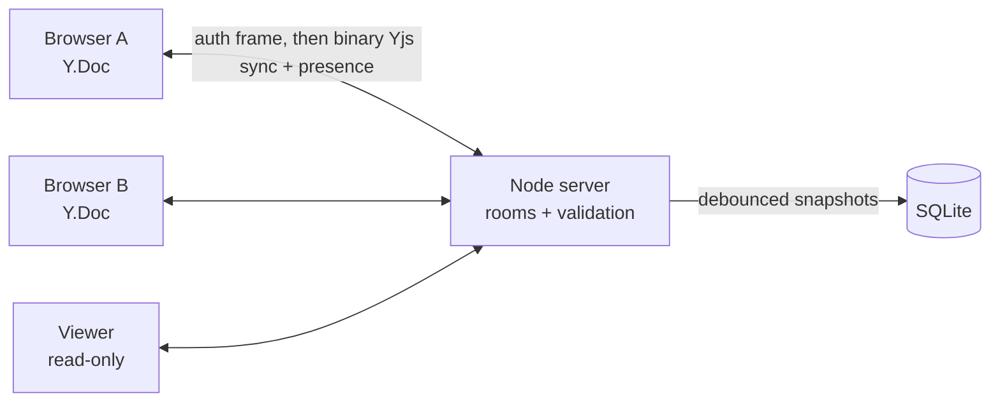

# Inkwell

**A real-time collaborative whiteboard.** Create a board, share a link, and draw, drop sticky notes, and see everyone's cursor live. Edits from many people merge automatically, even after someone goes offline and reconnects.

Built with **React**, **TypeScript**, **Yjs** (CRDTs), **WebSockets** (`ws`), and **SQLite** (Node's built-in `node:sqlite`).



## Features

- **Conflict-free editing:** each board is a Yjs document, so concurrent edits from any number of people merge deterministically. Offline edits sync when the connection returns.
- **Live presence:** named cursors and a "people here" count.
- **Tools:** pen (8 colors, adjustable width), eraser, sticky notes (draggable, 5 colors), pan and zoom, undo and redo of your own changes only.
- **Sharing:** separate **edit** and **view-only** links. Viewers see changes live but can't change anything.
- **Persistence:** boards survive restarts, with automatic reconnection and exponential backoff.

## Security design

There are no accounts. Access works by **capability links**, as in many document-sharing tools, so the design focuses on keeping those links secret and limiting what any connection can do.

| Concern | How it's handled |
|---|---|
| Guessable boards | Board ids are 128-bit random; edit and view keys are 256-bit random |
| Key storage | Only SHA-256 hashes of keys are stored. Keys are compared in constant time, including for boards that don't exist |
| Keys leaking via URLs | Keys live in the URL **fragment** (`#k=…`), which browsers never send to servers. The WebSocket URL carries no secrets; the key goes in the first message. `Referrer-Policy: no-referrer` |
| Viewer writes | The server **drops** document updates from view-only connections; it doesn't trust the client UI |
| Malicious content | Every element is validated against a strict schema (ids, colors from a palette, bounded numbers and lengths). The server **deletes invalid elements** before saving or relaying them, and clients validate again before rendering. Text is rendered as text, never HTML |
| Presence spoofing | A connection may only update the cursor it owns, and presence must match a small schema |
| Cross-site WebSocket hijacking | The `Origin` header is checked on every upgrade and on board creation |
| Abuse and denial of service | Per-connection message rate limit, 256 KB frame limit, 2 MB document limit, 5,000 elements per board, 50 connections per board, per-IP connection cap, per-IP board-creation limit, 5-second authentication deadline, and ping/pong to drop dead sockets |
| Browser hardening | `script-src 'self'` CSP with no inline scripts, `frame-ancestors 'none'`, `nosniff`, `Permissions-Policy`, COOP |
| Static files | Path traversal is blocked; hashed assets are cached as immutable |
| Supply chain | No native modules; npm install scripts blocked by default; `npm audit` and gitleaks in CI; Dependabot |

**Known limits:** anyone with an edit link can edit, and links can't be rotated yet (a natural next feature). Rate limits are per process. When deployed behind a proxy, set `TRUST_PROXY=true` only if that proxy sets `X-Forwarded-For`.

## Performance

`npm run loadtest -- 50 10 5` connects 50 editors to one board, and each draws 5 strokes per second for 10 seconds. All 50 clients and the server ran in one Node process on a laptop:

| Measurement | Result |
|---|---|
| Updates delivered | 115,052 of 115,052 (no loss) |
| Fan-out latency (writer to every other client) | p50 60 ms · p95 148 ms · p99 187 ms |

Because the simulated clients share the server's CPU, real browsers on separate machines should see lower latency.

## Run locally

Requirements: Node.js 22.13 or later (for `node:sqlite`). No database server or Docker is needed.

```bash
npm install
cp .env.example .env
npm run dev:server     # API and WebSockets on :8787
npm run dev:web        # Vite on http://localhost:5173 (proxies to :8787)
```

Open http://localhost:5173, click **Create a board**, then open the view-only link from **Share** in another window to see changes appear live.

Production-style, as one process:

```bash
npm run build && npm start     # serves the built app and WebSockets on :8787
docker build -t inkwell . && docker run -p 8787:8787 -v inkwell-data:/data inkwell
```

## Tests

```bash
npm test
```

The server tests start real servers and connect real WebSocket clients that speak the protocol. They cover:

- **Authentication:** wrong keys, unknown boards, auth timeout, and rejected origins.
- **Collaboration:** keys stored hashed, edits syncing between editors and viewers, viewer writes ignored, and invalid elements stripped before they're stored or relayed.
- **Persistence:** boards survive a server restart.
- **Abuse limits:** message floods, oversized frames, garbage messages, presence impersonation, board-creation and connection limits, and security headers.

Schema tests cover validation edge cases and eraser hit-testing.

## How sync works

1. The client opens `/ws` and sends `{"type":"auth","board","key"}`. The server checks the key's hash and replies `ready` with the role (`edit` or `view`).
2. Both sides exchange Yjs state vectors (*sync step 1*) and send each other only the missing updates (*sync step 2*).
3. After that, every local change is sent as a small binary update. The server applies it to its copy of the document, removes anything invalid, relays it to the other connections, and saves a snapshot to SQLite within a second.
4. Presence (cursor and name) travels on a separate channel and is discarded when the user leaves.

## Project layout

```
shared/   element schema and validation, wire protocol constants
server/   HTTP and WebSocket server, rooms (Yjs docs + presence), SQLite store
web/      React client: canvas renderer, tools, sticky notes, presence, sharing
tests/    integration tests with real sockets
scripts/  load test
```

## License

MIT
